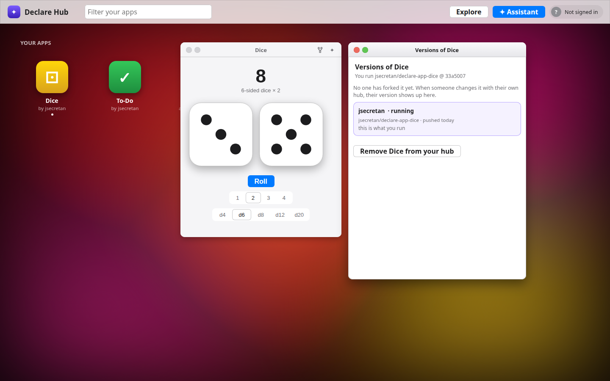

# Declare Hub

A web portal of small apps written in
[Declare](https://davidtemkin.github.io/declarelang/), where **every app is its
own GitHub repo** and a [pi](https://github.com/earendil-works/pi) agent changes
them while you use them.

- Your hub has a **registry**: a list of app repos, each pinned to a commit.
  The page shows them as tiles; press one and it opens in a window.
- Ask the assistant for a **new app** and it gets its own repo,
  `<you>/declare-app-<name>`, published from your hub.
- Press **✦** on an app's window to ask for a **change to just that app**. The
  change is saved to a repo of yours: the app's own repo if it's yours, else
  **a fork** made for you on the spot. Your registry follows.
- Press **⑂** on a window (or a tile) to see **every version of that app on
  GitHub**: the original and everyone's forks, with how each differs from
  yours. **Try** one in a preview window, then **Use** it, and your registry
  points at that fork from then on.
- **Explore** finds Declare apps anyone has published (repos tagged
  `declare-app`) and adds them to your hub.
- **Undo** takes back the agent's last change, on GitHub too.

<p align="center"></p>

It grew out of [Declare OS](https://github.com/jsecretan/declare-os), a desktop
the agent rewrites; this is the same engine pointed at GitHub instead.

## Run it

You need **Node 20+**, **git**, and **pi**
(`npm install -g @earendil-works/pi-coding-agent`). Then:

```
git clone https://github.com/jsecretan/declare-hub
cd declare-hub
npm install
npm start            # → http://127.0.0.1:8870/  (also on your LAN address)
```

The first start clones the default apps (Dice and To-Do) into `apps/`.

### Sign in to GitHub

The hub reads public app repos without signing in, but saving changes,
forking and creating repos need a token. It looks, in order, at
`GITHUB_TOKEN` or `GH_TOKEN`, then the GitHub CLI, then
`~/.config/declare-hub/token`. The easy way:

```
brew install gh        # macOS; on Linux: sudo apt install gh (or see cli.github.com)
gh auth login
```

Or make a [classic token](https://github.com/settings/tokens) with the `repo`
scope and put it in `~/.config/declare-hub/token`. Without a token, changes are
kept on your computer (their tiles say *changed here*) and **Publish** sends
them once you sign in.

### Choose a model

The agent defaults to a local Strata server (`strata` /
`qwen3.8-flash-next-iq3_s` on 127.0.0.1:8080). Any model pi supports works;
set `PI_PROVIDER` and `PI_MODEL`.

**Strata on another machine** (say, a Linux box with the GPUs, used from a
Mac): tunnel its port, so nothing on the server has to change.

```
ssh -N -L 8080:127.0.0.1:8080 you@gpu-box      # leave this running
```

Then give pi the same `strata` provider entry the server uses, in the Mac's
`~/.pi/agent/models.json`:

```json
{
  "providers": {
    "strata": {
      "api": "openai-completions",
      "apiKey": "strata",
      "baseUrl": "http://127.0.0.1:8080/v1",
      "models": [
        { "id": "qwen3.8-flash-next-iq3_s", "contextWindow": 65536, "maxTokens": 16384,
          "input": ["text", "image"], "reasoning": true }
      ]
    }
  }
}
```

and `npm start` as usual.

**A hosted model**: set the provider's key and name it.

```
export ANTHROPIC_API_KEY=sk-ant-…
PI_PROVIDER=anthropic PI_MODEL=claude-sonnet-5-5 npm start
```

The same goes for `OPENAI_API_KEY` with `openai`, `GEMINI_API_KEY` with
`google`, `OPENROUTER_API_KEY` with `openrouter`, and the rest
(`pi --help` lists them; `pi --list-models` shows model ids once a key is set).

**Ollama on the Mac itself**: add it to `~/.pi/agent/models.json`

```json
{
  "providers": {
    "ollama": {
      "api": "openai-completions",
      "baseUrl": "http://127.0.0.1:11434/v1",
      "apiKey": "ollama",
      "models": [ { "id": "qwen3.8:27b", "contextWindow": 131072, "input": ["text", "image"], "reasoning": true } ]
    }
  }
}
```

and start with `PI_PROVIDER=ollama PI_MODEL=qwen3.8:27b npm start`.

After each change the hub shows the model a picture of the app, taken with
headless Chrome: an installed Google Chrome works, or
`npx puppeteer browsers install chrome`, or set `CHROME` to one. That needs a model that takes images; with a text-only one, start
with `LOOK=0`.

### The same hub on two computers

Point both at one registry repo, and each start pulls it and each change
pushes it:

```
HUB_REGISTRY_REPO=<you>/declare-hub-registry npm start
```

Create that repo (private is fine) on GitHub first, empty. The apps
themselves are already on GitHub, so the second computer clones them at the
same commits. A running hub picks up the other computer's changes when it
next starts.

## How it is put together

```
shell.declare          the host page: the portal in an island, the assistant
                         panel (and the drawer it becomes beside a window)
hub/portal.declare     the portal: header, app tiles, windows
hub/system/            the window manager and launcher, window chrome, the
                         forks and Explore windows
hub/AGENTS.md          the agent's instructions
server/agent.mjs       the bridge: pi --mode rpc ↔ chat over SSE; verify,
                         repair, look, commit, publish, undo; the hub's API
server/registry.mjs    the registry, the app checkouts, publish / fork / choose
server/github.mjs      the GitHub API and git over HTTPS with your token
server/look.mjs        a picture of one app at its window size
registry.default.json  the apps a new hub starts with
apps/                  (not checked in) one git clone per app, at its commit
previews/              (not checked in) forks fetched to try
state/                 (not checked in) the registry repo, chats, app data
```

**An app repo** holds `declare-app.json` beside its program:

```json
{ "id": "dice", "title": "Dice", "main": "dice.declare",
  "glyph": "⚀", "hue1": "#FFD60A", "hue2": "#D9A21B",
  "blurb": "Big dice to throw.", "width": 380, "height": 460 }
```

Tag the repo with the `declare-app` topic and Explore finds it.

**A turn**: the bridge notes every app's commit, then hands your words to pi
(working in `apps/`). In a window's chat, the agent is told to stay inside
that app, and anything it changes elsewhere is put back. When it settles, each
changed or new app is checked (`declare-app.json`, then `declare-verify`), and
problems go back to the agent to fix (twice at most). Then the bridge takes a
picture of each and has the agent check how it looks. Each changed app is
committed in its own repo and **published**:

- your repo → pushed to its default branch;
- someone else's → pushed to your repo in the same fork network: the
  original if it's yours, else your fork, made now;
- if that branch has moved on since, the change goes to a new branch
  (`hub-<date>`), so nothing there is ever overwritten.

The registry entry then names that repo and commit, and the app's open windows
reload in place on the new code.

**Choosing another version** (⑂ → Use) fetches that fork's commit into the
app's checkout and repoints the registry; it is refused while the app has a
change that isn't on GitHub yet, so nothing is lost.

Environment: `PI_PROVIDER`, `PI_MODEL`, `PI_EXTENSIONS=1` (let pi load your
extensions and MCP servers), `LOOK=0`, `CHROME`, `STRATA_HEALTH`,
`HUB_REGISTRY_REPO`, `GITHUB_TOKEN`, `AGENT_PORT` (8871), `DECLARE_URL`.
The page's port is in `declare.json` (8870).

The window chrome is adapted from the Declare distro's desktop example
(`apps/desktop/desktop.declare`, MIT).
